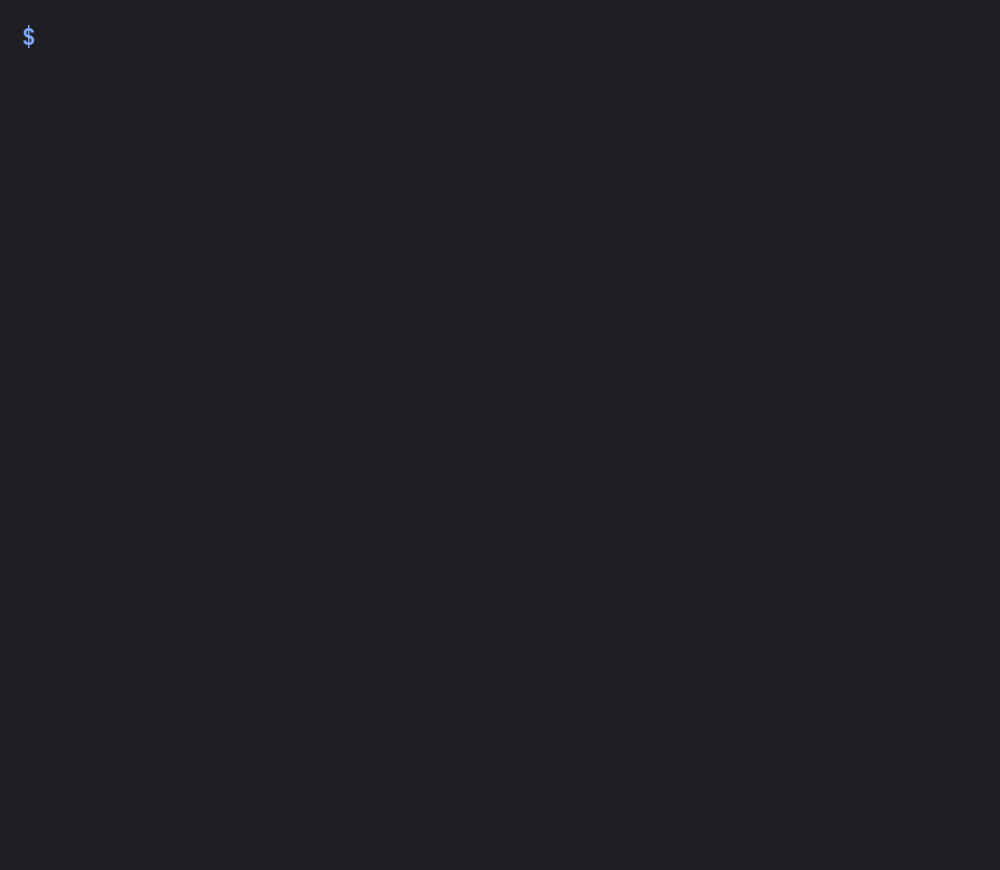
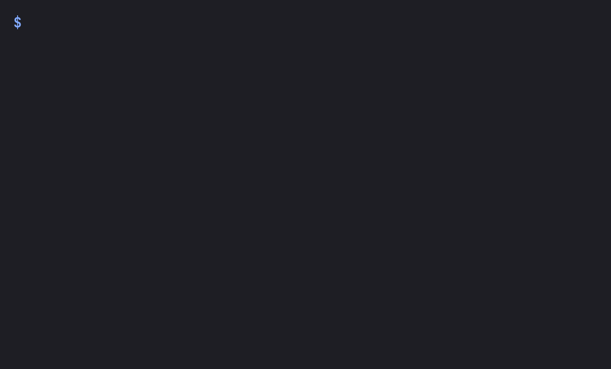

# term-styling

Script output that reads well everywhere it lands: terminals, pipes, and log files.

- 📄 **Plain ASCII when piped** (`[OK]`, `[!]`, `A1  https://…`), so logs stay greppable
- 🎨 **Unicode symbols and 16-color SGR** on a terminal
- 🔗 **Clickable [OSC 8](https://gist.github.com/egmontkob/eb114294efbcd5adb1944c9f3cb5feda) hyperlinks** where supported
- ✨ **[Nerd Font](https://www.nerdfonts.com/) glyphs** when asked for
- 📊 **Tables and progress bars** that turn into plain records and silence when piped
- 🔀 **Per-stream detection**: piped stdout and terminal stderr each style correctly
- 🐍 **Standard library only**, Python 3.9+



See the same script for [the other displayed tiers 0 and 1](#tiers).

There are two more demos further down: [tables](#tables), the counterpart of `uv runpython -m rich.table`, and [progress lines](#progress), the counterpart of `uv run python -m rich.progress`.

(Regenerate all five animations with `uv run docs/make_demo.py`; set `DEMO_FONT` and `DEMO_FONT_BOLD` to a Nerd Font for tier 2.)

## Install

### From PyPI (recommended)

The package is `term-styling` on PyPI and imports as `term_styling`.
Minor versions can break compatibility before 1.0 (see [CHANGELOG.md](CHANGELOG.md)), so cap the minor version:

```bash
uv add 'term-styling>=0.3,<0.4'      # in a uv project
pip install 'term-styling>=0.3,<0.4' # anywhere else
```

In a single-file script with [PEP 723](https://peps.python.org/pep-0723/) inline metadata:

```python
# /// script
# requires-python = ">=3.9"
# dependencies = ["term-styling>=0.3,<0.4"]
# ///
```

### From the repository

For changes on `main` that are not released yet, depend on the git repository.
Pin a release tag (`@v0.3.0`) or a full commit hash so later pushes cannot change what you get:

```bash
uv add git+https://github.com/codydunne/term_style --rev <tag or full commit hash>
```

```python
# dependencies = ["term-styling @ git+https://github.com/codydunne/term_style@<tag or full commit hash>"]
```

### Vendored

Copy `src/term_styling/__init__.py` next to a script as `term_styling.py`, with a comment naming this repository and the version copied (`__version__` in the file).
It has no imports outside the standard library, and `uv run term_styling.py` runs its selftest.

## Tiers

| tier | when | output |
|---|---|---|
| 0 | stream is not a TTY; `NO_COLOR` is non-empty; `CI` is non-empty and not `false`/`0` (any case); `TERM=dumb`; or the stream's encoding cannot print every one of `✓✗⚠→—✎≡─` (a Latin-1 locale, `PYTHONIOENCODING=ascii`) | ASCII, no escapes; links print as `label  url` |
| 1 | a terminal | unicode symbols, color, OSC 8 links |
| 2 | a terminal and `NERD_FONT=1` | as 1, with Font Awesome glyphs from a Nerd Font |

### Tier 0

With `NO_COLOR=1` and then with stdout redirected to a log while stderr stays on the terminal:




### Tier 1 

In a terminal without a Nerd Font:


### Tier 2: Enabling Top-Tier Formatting

Install a [Nerd Font](https://www.nerdfonts.com/font-downloads), select it as your terminal's font, and set `NERD_FONT=1`:


(Duplicate of the animation at the top.)

**macOS:**

```bash
brew install --cask font-jetbrains-mono-nerd-font
echo 'export NERD_FONT=1' >> ~/.zshrc
```

Then pick the font in your terminal's settings (Terminal: Settings → Profiles → Text → Font; iTerm2: Settings → Profiles → Text → Font).

**Windows:**
With the [NerdFonts](https://github.com/PSModule/NerdFonts) pwsh module, which installs into `C:\WINDOWS\Fonts`:

```pwsh
Install-PSResource -Name NerdFonts
Import-Module -Name NerdFonts
Install-NerdFont -Name 'JetBrainsMono', 'CascadiaCode'   # Get-NerdFont | Select-Object Name lists the rest
Add-Content $PROFILE "`$env:NERD_FONT = '1'"
```

Then pick the font in Windows Terminal: Settings → Profile → Appearance → Font face.

Over SSH or in WSL the font is the local terminal's; only the variable needs setting on the remote side.

`term_styling.TIER` is stdout's tier and `term_styling.ERR_TIER` stderr's, computed at import.

### Import side effects

A `sys.stdout` or `sys.stderr` whose encoding cannot print those symbols, and whose errors handler is still the default `strict`, is switched to `errors='backslashreplace'` on import.
Tier 0 keeps this module's own output ASCII, but a caller's text (a title with an em dash) would otherwise still raise `UnicodeEncodeError` on the next `print()`; it prints as `\u2014` instead.
`link`, `paint`, `mark`, `change`, `divider`, and `table` take an optional `tier_` and otherwise use `TIER`; `skip`, `error`, `warn`, and `die` write to stderr at `ERR_TIER`, and so does `progress`, which takes a `tier_` of its own.

## Usage

```python
import term_styling
from term_styling import change, divider, link, mark, paint

print(divider())
print(mark('ok', '5 in sync'))
print(mark('warn', 'points differ'))
print(change('due_at', '2026-09-17 23:59', '2026-09-18 23:59'))
print(link('https://example.org/a1', 'A1'))
print(paint('dimmed', 'dim'))

term_styling.warn('one yellow line on stderr')
term_styling.skip('no API_TOKEN')  # red on stderr, and recorded
if term_styling.SKIPPED:  # recap at the end of the run
    print('skipped:', *term_styling.SKIPPED, sep='\n  ')
term_styling.die('cannot continue', code=2)  # red on stderr, then exit
```

`SYMBOLS` maps a state to its `(plain, unicode, glyph)` forms and `COLORS` to its SGR code.
A script with states of its own extends both, and `mark()`/`paint()` pick them up.
A state needs a symbol to be marked but not a color (`arrow`, `none`, `edit`, and `file` have none), and `mark()` leaves an uncolored state plain.
A state whose symbol is empty at a tier (`edit` and `file` at tier 0) marks as the text alone.
`paint()` needs a color and raises `KeyError` for an unknown one at every tier, so a typo fails in a piped test run, not only in a terminal.

```python
term_styling.SYMBOLS.update({'held': ('held', '◐', '\uf04c')})
term_styling.COLORS.update({'held': '33'})
```

### Tables

`table(rows, headers=None, align='')` returns the rows as aligned columns, one line per row at every tier.


```python
rows = [
    ('A1', 10, mark('ok', 'in sync')),
    ('A22', 5, mark('warn', 'points differ')),
    ('A3', None, 'held'),
]
print(term_styling.table(rows, headers=('id', 'pts', 'state'), align='lr'))
```

Piped (tier 0), that is the header and the rows and nothing else, so every line is a record for `grep` and `awk`:

```text
id   pts  state
A1    10  [OK] in sync
A22    5  [!] points differ
A3     -  held
```

On a terminal the header is bold with a dim rule under it.
`align` takes one `l` or `r` per column and is left where it runs out; any other character raises `ValueError` at every tier.
Cells may be styled with `mark()`, `paint()`, or `link()`, or by another library: widths are measured without escape sequences, which are passed through whole.
East Asian wide characters count as two columns, and so does an emoji built from several codepoints (a ZWJ family, a flag, a skin tone, a keycap).
A `None` cell prints as the `none` symbol (`-`, or `—` on a terminal), and a line break, tab, or other control character inside a cell becomes a space.
Cells are never wrapped or truncated, because a wrapped row is no longer one record.

### Progress

`progress(items, label='', total=None)` yields the items and redraws one line on **stderr**:


```python
for path in term_styling.progress(paths, 'uploading'):
    upload(path)
    print(mark('ok', path))  # lands above the line
print(mark('ok', f'{len(paths)} uploaded'))
```

```text
uploading ━━━━━━━━━━━━━━━━━━━━━━━━━━━━━━ 12/40 eta 0:28
```

At tier 0 (stderr piped, `CI`, `NO_COLOR`) it prints nothing at all and wraps nothing, so logs never collect redraws.
The line is erased when the loop runs to its end; print the outcome yourself.
After a `break` or an exception it is erased when the generator is closed.
CPython does that at once for a `for` loop written directly over the call, but the language does not promise it, and an iterator you keep in a variable holds its line until you close it.
Where that matters, close it yourself:

```python
from contextlib import closing

with closing(term_styling.progress(paths, 'uploading')) as items:
    for path in items:
        if not upload(path):
            break
```
`total` defaults to `len(items)`; an iterator without a length shows a running count and the time elapsed, with no bar.
The estimate is the mean pace so far.
Redraws for finished items are capped at ten a second; each line printed inside the loop costs one more.
The line is as wide as stderr's terminal allows (or `COLUMNS`), whatever stdout is.
If the terminal stops accepting writes, the drawing stops and the loop carries on.

While a loop runs, `sys.stderr` is replaced by a thin stand-in, and `sys.stdout` too when it is a terminal, so anything printed inside the loop appears above the line and both streams are restored afterwards.
A piped `sys.stdout` is left untouched.
Loops may nest or run in threads: each gets its own line, in the order they started.

```python
for course in term_styling.progress(courses, 'courses'):
    for item in term_styling.progress(course.items, course.name):
        sync(item)
```

### When to use rich instead

`table` and `progress` are deliberately the small cases.
Reach for [rich](https://github.com/Textualize/rich) when you need wrapped or truncated cells, borders, spinners, transfer speeds, or a bar that keeps ticking while one slow item runs (here a line redraws only when an item finishes or something prints).
The two combine: build a rich `Console` only when `term_styling.TIER` is non-zero, and keep the plain path here.

### Shared state

Both dictionaries, `SKIPPED`, and the tiers are module globals shared by everything in the process.
To pin a tier in a test, assign `term_styling.TIER = 0` (read it back as `term_styling.TIER`; a `from term_styling import TIER` binding does not follow the assignment).

Styled strings are for display only: never compare, POST, or write them to a file.
At tier 0 every function returns the unstyled text byte for byte, which `selftest()` checks.
A script that extends the tables can call `term_styling.selftest()` from its own tests: it checks every state in `SYMBOLS` and `COLORS`, the caller's included, and every branch of `tier()`, and does not rely on `assert`, so it still fails under `python -O`.
That is also what checks a vendored copy, which carries no `tests/`.

## Development

Ruff, ty, and pytest are pinned in the `dev` group of `uv.lock`, which CI uses too.

```bash
uv sync
uv run pytest
uv run python -m term_styling          # the in-module selftest, also callable from other scripts' selftests
uv run ruff check . && uv run ruff format --check .
uv run ty check src tests
```

## Releasing to PyPI

The package is published as `term-styling` and imported as `term_styling`.
PyPI never lets you reuse a version number, even after a deletion, so a bad upload has to be fixed with a new version.

Publishing runs in GitHub Actions (`.github/workflows/release.yml`) through [trusted publishing](https://docs.pypi.org/trusted-publishers/), so there are no API tokens to create or store.
Pushing a `vX.Y.Z` tag publishes to PyPI; running the workflow by hand publishes to TestPyPI.
The version lives in `pyproject.toml` and, as a literal so vendored copies carry it too, in `__version__` in `src/term_styling/__init__.py`; a test fails if they differ.

### Initial release

One-time setup, then the same steps as every later release:

1. Create accounts on [pypi.org](https://pypi.org) and [test.pypi.org](https://test.pypi.org) (they are separate) and turn on two-factor authentication.
2. On each, add a *pending* trusted publisher (Account settings → Publishing), which works before the project exists: project `term-styling`, this GitHub owner and repository, workflow `release.yml`, environment `pypi` on PyPI and `testpypi` on TestPyPI.
   The first upload to each index claims the name and turns the pending publisher into a normal one.
3. Optional: in the GitHub repository settings, add required reviewers to the `pypi` environment so every release waits for a click.
4. Follow [Updates](#updates).

### Updates

1. Bump the version, set the same `__version__` in `src/term_styling/__init__.py`, and add a `CHANGELOG.md` entry:

   ```bash
   uv version --bump patch   # or minor / major; also updates uv.lock
   ```

2. Run the checks from [Development](#development), commit, push to `main`, and wait for CI to go green.
3. Optional dry run: run the **Release** workflow by hand (Actions tab, or `gh workflow run release.yml`), then check the TestPyPI package:

   ```bash
   uv run --isolated --no-project --index https://test.pypi.org/simple/ --with term-styling==$(uv version --short) python -m term_styling
   ```

4. Tag the green commit and push the tag. The workflow checks that the tag matches `pyproject.toml`, builds, runs the selftest on the wheel, and publishes:

   ```bash
   git tag -a "v$(uv version --short)" -m "term-styling $(uv version --short)" && git push origin "v$(uv version --short)"
   ```

To build and selftest locally without publishing:

```bash
uv build --clear
uv run --isolated --no-project --with dist/*.whl python -m term_styling
```

## Known limitations

- Windows consoles that do not enable virtual-terminal processing (legacy `conhost.exe` without it turned on) print the escapes literally; Windows Terminal and VS Code's terminal are fine.
  `NO_COLOR=1` is the workaround.
  Not handled in code: turning VT processing on takes Win32 console calls, and nothing here tests them yet.
- Column widths follow the Unicode rules, but terminals disagree about emoji: some draw a ZWJ sequence as separate glyphs or a U+FE0F symbol one column wide, and a table row holding one can be off by a column there.
- `progress()` moves only what is written through `sys.stdout`/`sys.stderr` above its line. A `logging` handler created before the loop holds the real stream, so its records land on the line, as do `sys.stdout.buffer`, `os.write`, and a subprocess sharing the terminal.
- A progress line starts at the left margin and erases what is there: finish a half-printed line (`print('Fetching... ', end='')`) before the loop. Inside the loop the line waits for a printed line to end, so a loop that prints dots with `end=''` shows no bar.
- A label wider than the terminal smears the redraw.
- `progress()` is a generator: after a `break` or an exception its line stays until the generator is closed. CPython closes one that nothing else refers to at once; other implementations may not, and an iterator kept in a variable is never closed for you. Use `contextlib.closing` (see [Progress](#progress)) for a guarantee.
- Colors are the 16-color SGR set only; there is no truecolor or 256-color path.
- The encoding probe covers the base symbols (the progress bar's `━` is outside it and falls back to `─`). A caller's own symbols outside that set (`●`, say) are not checked, though in practice any encoding that prints all of the base set is a Unicode one.

## License

Apache-2.0; see [LICENSE](LICENSE) and [NOTICE](NOTICE).
